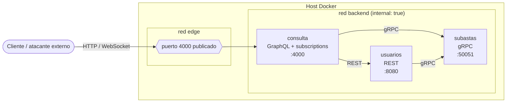

# Diagrama de topología

> Placeholder. TODO(equipo): reemplazar por el diagrama definitivo (exportarlo
> a `docs/topologia.png` o mantenerlo en Mermaid) y completar las tablas.

## Borrador de partida

Refleja lo que hoy declara `docker-compose.yml`. GitHub renderiza Mermaid.

## Enlaces y protocolos

| Origen   | Destino  | Protocolo             | Modo vulnerable | Modo blindado |
|----------|----------|-----------------------|-----------------|---------------|
| cliente  | consulta | HTTP + WebSocket      | texto plano     | TODO(equipo)  |
| consulta | subastas | gRPC (HTTP/2)         | texto plano     | TODO(equipo)  |
| consulta | usuarios | REST (HTTP/1.1)       | texto plano     | TODO(equipo)  |
| usuarios | subastas | gRPC (HTTP/2)         | texto plano     | TODO(equipo)  |

## Pendiente para el diagrama final

- TODO(equipo): fronteras de confianza y posición del atacante en cada ataque.
- TODO(equipo): dónde termina TLS y qué certificados usa cada enlace.
- TODO(equipo): dónde vive cada defensa (authz, límites, rate limiting).
- TODO(equipo): captura de tráfico de un enlace en cada modo como evidencia.
